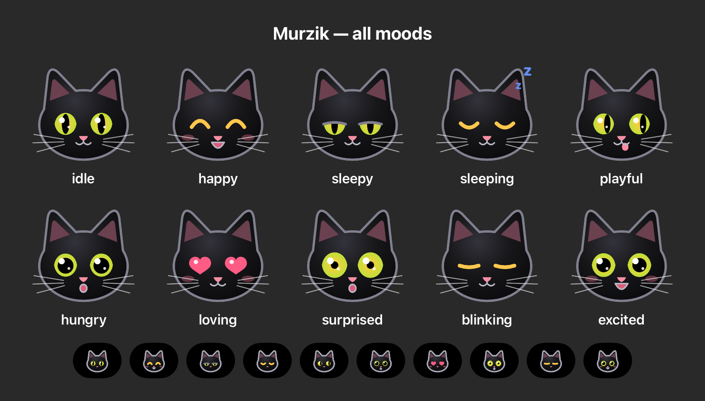
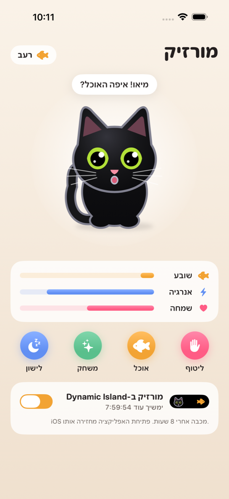
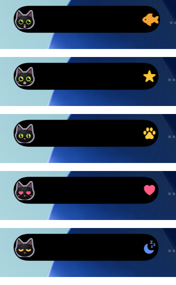
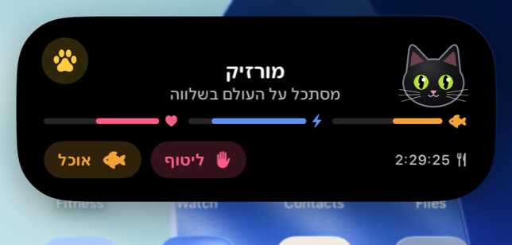

# MURZIK 🐈‍⬛

A small black cat who lives in the iPhone's Dynamic Island.

<p align="center">
  
</p>

<p align="center">
  
  
</p>
<p align="center"></p>
<p align="center"><sub>Screenshots taken automatically by the UI test in the iOS Simulator (CI).</sub></p>

## מה זה

מורזיק הוא חתול שחור קטן שגר ב-Dynamic Island של האייפון.

- **באפליקציה:** אפשר ללטף אותו (גם בנגיעה בחתול עצמו), להאכיל, לשחק ולהשכיב לישון. הוא ממצמץ, מקשקש בזנב ונושם.
- **מה הוא מרגיש:** יש לו שלושה צרכים: שובע, אנרגיה ושמחה. הם משתנים עם הזמן, גם כשהאפליקציה סגורה.
- **מצבי רוח:** עשרה מצבים: רגוע, שמח, ישנוני, ישן, שובב, רעב, אוהב, מופתע, ממצמץ ונלהב.
- **ב-Dynamic Island:** הפרצוף שלו מופיע משמאל, וסמל מצב הרוח מימין. בלחיצה ארוכה נפתחת תצוגה מורחבת עם כפתורי **ליטוף** ו**אוכל** שעובדים בלי לפתוח את האפליקציה. באותה תצוגה יש גם שעון שסופר לאחור עד שהוא יהיה רעב.
- **במסך הנעילה:** אותו כרטיס עם אותם כפתורים.

## התקנה על האייפון (Windows, בלי Mac)

צריך: אייפון עם Dynamic Island (14 Pro ומעלה, iOS 17+), כבל, מחשב Windows ו-Apple ID רגיל.

1. **הורדת האפליקציה:** מורידים את `Murzik.ipa` מדף ה-[Releases](https://github.com/Bogadin/cat-island/releases/latest).
2. **התקנת התוכנות:** מתקינים את [Sideloadly](https://sideloadly.io). צריך גם את **iTunes** ו-**iCloud** בגרסה מהאתר של אפל, ולא מה-Microsoft Store. בדף ההורדה של Sideloadly יש קישורים לשתיהן.
3. **חיבור הטלפון:** מחברים את האייפון בכבל. בטלפון מאשרים "סמוך על המחשב הזה".
4. **התקנה:** פותחים את Sideloadly, גוררים אליה את `Murzik.ipa`, מקלידים את ה-Apple ID ולוחצים **Start**. את הסיסמה מקלידים רק בתוך Sideloadly.
   - חשוב שלא לסמן אפשרות שמסירה הרחבות (extensions/plugins). ההרחבה היא ה-Dynamic Island.
5. **אישור המפתח באייפון:** הגדרות ← כללי ← ניהול התקן ו-VPN, בוחרים את ה-Apple ID ולוחצים **סמוך**.
6. **מצב מפתחים:** הגדרות ← פרטיות ואבטחה ← מצב מפתחים ← מפעילים. הטלפון יבקש להפעיל את עצמו מחדש.
7. **הפעלה:** פותחים את מורזיק. החתול עולה ל-Dynamic Island לבד, ואפשר גם להדליק או לכבות אותו במתג שבתחתית המסך.

### חשוב לדעת

- **חידוש כל 7 ימים:** עם Apple ID חינמי האפליקציה מפסיקה לעבוד אחרי 7 ימים. כדי לחדש, מחברים לכבל ולוחצים שוב **Start** ב-Sideloadly. אפשר גם להפעיל ב-Sideloadly חידוש אוטומטי ברשת ה-Wi-Fi. חשבון מפתח של אפל (99$ לשנה) מבטל את המגבלה.
- **8 שעות:** iOS מוריד Live Activity מה-Dynamic Island אחרי 8 שעות לכל היותר. כשפותחים את האפליקציה, מורזיק חוזר.
- **אם הוא לא מופיע:** הגדרות ← מורזיק ← לוודא ש**פעילויות חיות** מופעלות.
- **אחרי הפעלה מחדש של הטלפון:** פותחים את האפליקציה פעם אחת ומורזיק חוזר.
- **החלקה שלו ממסך הנעילה:** זה מכבה את המתג. כדי להחזיר אותו, מדליקים שוב את המתג באפליקציה.
- **חידוש:** כדאי לחדש תמיד עם אותו Apple ID, כדי שמורזיק יזכור את המצב שלו.

## What iOS allows (and what it doesn't)

| | Status |
|---|---|
| Cat in compact / minimal / expanded Dynamic Island and on the Lock Screen | ✅ ActivityKit Live Activity |
| Pet / Feed buttons in the expanded island and on the Lock Screen | ✅ `LiveActivityIntent` (iOS 17), runs in the app process |
| Reactions in the island (hearts, excitement), then settling back | ✅ two content updates, ~6 s apart |
| Turning hungry on time with the app closed | ✅ `staleDate` = hunger time + self-updating countdown |
| Blinking, tail, breathing | ✅ in the app only |
| Continuous animation inside the Dynamic Island | ❌ not possible. Live Activities only animate between content updates (≤2 s) |
| Staying in the island forever | ❌ iOS ends a Live Activity after at most 8 h. Opening the app restarts it |
| Mood changes driven by time while the app is fully closed (other than hunger) | ⚠️ needs a push server. Picked up the next time the app or a button runs |

## Project layout

```
App/        SwiftUI app (main screen, model, app icon)
Shared/     Compiled into the app *and* the widget extension
  Model/        PersonalityEngine (pure rules), PetStorage, strings
  Character/    Murzik drawn with SwiftUI shapes (CatFace, CatFigure)
  LiveActivity/ ActivityAttributes, island/lock-screen views, intents, controller
Widgets/    WidgetKit extension: the Live Activity configuration
Tests/      Unit tests + render tests (PNG output)
UITests/    Simulator test: launches the app, screenshots app + Dynamic Island
project.yml XcodeGen spec (the .xcodeproj is generated)
```

## Build

CI (`.github/workflows/build.yml`) runs on a GitHub macOS runner. It does four things:

1. Generates the Xcode project with XcodeGen.
2. Runs the unit, render and UI tests on an iPhone simulator.
3. Builds an unsigned device IPA and publishes it as the `latest` release.
4. Pushes renders and logs to the `ci-output` branch.

Locally on a Mac:

```sh
brew install xcodegen
xcodegen generate
open Murzik.xcodeproj
```
